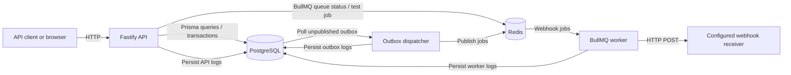

# Event RSVP API Architecture

## Overview

The application is a Node.js service for managing events and guest RSVPs. Fastify exposes the HTTP API and browser-based test console. PostgreSQL, accessed through Prisma, is the source of truth for event and RSVP data. Redis and BullMQ provide asynchronous webhook delivery, processed by a separate worker process.

The API and worker run directly on the host in the local setup. Docker Compose is used for PostgreSQL and Redis.

## System context



### Components

- **Fastify API (`src/server.js`, `src/app.js`)**: Starts the HTTP server, registers event, RSVP, queue-monitoring, and server-log routes, and owns the API's Redis queue connection. The browser console is served at `/` and `/test`.
- **Application services (`src/modules`)**: Validate and implement event and RSVP operations. The RSVP service keeps capacity changes, idempotency responses, and corresponding outbox records in PostgreSQL transactions.
- **PostgreSQL / Prisma (`src/plugins/prisma.js`, `prisma/schema.prisma`)**: Stores events, RSVPs, idempotency records, unpublished/published outbox events, and persisted server logs.
- **Redis / BullMQ (`src/queue/webhook.queue.js`)**: Holds webhook jobs and their processing/retry state. Queue jobs use the outbox event ID as a stable job ID.
- **Outbox dispatcher (`src/queue/outbox-dispatcher.js`)**: Runs in the worker process, polls PostgreSQL for unpublished outbox rows, and enqueues them in BullMQ.
- **Webhook worker (`src/workers/webhook.worker.js`)**: Runs separately from the API, consumes BullMQ jobs, and sends JSON `POST` requests to `WEBHOOK_URL`.
- **Test console (`public/index.html`)**: Provides a local browser interface for exercising API routes, queue monitoring, concurrency scenarios, and persisted server logs.

## RSVP write and webhook flow

```mermaid
sequenceDiagram
    participant C as Client
    participant A as Fastify API
    participant P as PostgreSQL
    participant D as Outbox dispatcher
    participant R as Redis / BullMQ
    participant W as Webhook worker
    participant H as Webhook receiver

    C->>A: POST /events/{id}/rsvps + Idempotency-Key
    A->>P: Begin transaction; lock event row
    A->>P: Check idempotency and active email
    A->>P: Create RSVP + outbox event + saved response
    A->>P: Commit
    A-->>C: RSVP response
    D->>P: Poll unpublished outbox rows
    D->>R: Add job using outbox ID
    D->>P: Mark row published
    R->>W: Deliver job
    W->>H: HTTP POST JSON
    H-->>W: HTTP response
```

The RSVP response does not wait for the webhook receiver. A successfully committed RSVP and its outbox event are persisted together; dispatch and delivery happen asynchronously.

## RSVP consistency and concurrency

- Creating an RSVP and cancelling an RSVP lock the associated event row with PostgreSQL `SELECT ... FOR UPDATE`. This serializes capacity-changing work for the same event while allowing unrelated events to proceed independently.
- A new RSVP is `CONFIRMED` when the number of confirmed guests is below the event capacity; otherwise it is `WAITLISTED`.
- Cancelling a confirmed RSVP promotes the earliest waitlisted guest, ordered by `createdAt` and then ID.
- Emails are trimmed and lowercased before use. A PostgreSQL partial unique index prevents more than one non-cancelled RSVP for an event/email pair. A cancelled guest can register again.
- RSVP create and cancel operations require an `Idempotency-Key`. The database stores a request hash and response under a key and operation scope. Repeating a request with the same key and same input returns the stored response; reusing that key with different input returns `IDEMPOTENCY_KEY_REUSED`.
- RSVP changes, any promotion, idempotency responses, and their webhook outbox events are committed in the same database transaction.

## Outbox and delivery semantics

The outbox pattern prevents a committed RSVP change from being lost merely because Redis or the webhook receiver is temporarily unavailable at that moment. The dispatcher polls unpublished records every second in batches of up to 50. It adds a BullMQ job using the outbox row's ID and then records `publishedAt`.

BullMQ retries failed webhook deliveries `WEBHOOK_MAX_RETRIES` times after the initial attempt (default `2`, three total attempts), with exponential backoff starting at one second. Set it to `0` to disable retries. The worker rate-limits processing to one webhook job per `WEBHOOK_RATE_LIMIT_MS` interval (default one second) to avoid overwhelming rate-limited receivers; queued jobs wait in Redis and RSVP API responses do not wait. Webhook calls have a 10-second timeout. Failed delivery attempts are visible in queue job state and worker logs.

Delivery is **at least once**, not exactly once. If the dispatcher adds a job but crashes before recording `publishedAt`, it may encounter the same outbox row again. The stable job ID helps avoid duplicate queue jobs while a job with that ID is retained, but it cannot guarantee that the external receiver will observe exactly one HTTP request in all crash/retry scenarios. Webhook consumers should therefore handle duplicate events idempotently.

The outbox's `attempts` and `lastError` fields track dispatcher publishing attempts/failures. BullMQ separately tracks delivery attempts and job failures.

## HTTP interface

Primary API routes:

| Method | Route | Purpose |
|---|---|---|
| `GET` | `/health` | Basic process health response |
| `POST` | `/events` | Create an event |
| `GET` | `/events` | List events with RSVP counts |
| `GET` | `/events/{eventId}` | Get one event with RSVP counts |
| `GET` | `/events/{eventId}/rsvps` | List RSVPs with optional status filter and pagination |
| `POST` | `/events/{eventId}/rsvps` | Register a guest; requires `Idempotency-Key` |
| `POST` | `/rsvps/{rsvpId}/cancel` | Cancel an RSVP; requires `Idempotency-Key` |
| `GET` | `/worker/queue` | Inspect BullMQ counts, worker count, and recent job metadata |
| `POST` | `/worker/queue/test-job` | Enqueue a test webhook in development mode only |
| `GET` | `/server-logs` | Read persisted logs with optional source/level filters and pagination |
| `GET` | `/`, `/test` | Serve the browser API test console |

Validation and application errors use the response shape `{ "error": { "code": "...", "message": "..." } }`.

## Data model

| Model | Role |
|---|---|
| `Event` | Event title, date, location, and capacity |
| `Rsvp` | Guest registration, status (`CONFIRMED`, `WAITLISTED`, `CANCELLED`), and timestamps |
| `IdempotencyRecord` | Request hash and response for replay-safe RSVP create/cancel operations |
| `OutboxEvent` | Durable webhook event payload and dispatcher publication state |
| `ServerLog` | Structured API, worker, and outbox logs with level, source, message, JSON context, and timestamp |

The migrations in `prisma/migrations` define the PostgreSQL schema, indexes, capacity constraint, and partial unique index for active RSVPs.

## Logging and operational visibility

API request/response metadata and API errors are persisted with source `API`. Worker delivery and lifecycle messages use `WORKER`; outbox dispatch messages use `OUTBOX`. Logs are written to PostgreSQL and are also sent to the process console by the persistent worker logger.

Request log context includes the request ID, method, path (without query string), status code, and response time. Request bodies and headers are not recorded. The `/server-logs` route and test console can filter logs by source or severity; these logs are retained until manually removed.

`GET /worker/queue` reports Redis/BullMQ state. It does not expose job payloads. A queue can contain jobs when no worker is connected; a connected worker is needed to process them. Worker and outbox log entries are generated only when the worker process is running and relevant lifecycle or dispatch activity occurs.

The health endpoint is a lightweight HTTP check; it does not verify that PostgreSQL, Redis, or the webhook receiver is healthy.

## Local process and configuration

The API and worker are separate Node.js processes:

```text
npm run dev       # API with Node watch mode
npm run worker    # Outbox dispatcher and webhook consumer
```

Both use `DATABASE_URL`; the API and worker also use `REDIS_URL` (default `redis://localhost:6379`). The worker requires a valid `WEBHOOK_URL` and accepts `WEBHOOK_MAX_RETRIES` (non-negative retry count after the initial delivery; default `2`) and `WEBHOOK_RATE_LIMIT_MS` (positive integer milliseconds between webhook jobs; default `1000`). The API listens on `HOST` (default `0.0.0.0`) and `PORT` (default `3000`).

After changing the Prisma schema or applying migrations, regenerate the client (`npm run db:generate`) and restart processes using it. Apply schema migrations with `npm run db:migrate`. Refer to [README.md](./README.md) for prerequisites and the complete setup steps.

## Design choices, scaling path, and tradeoffs

The current design favors correctness and a small operational footprint over maximum throughput:

- **PostgreSQL transactions and an event-row lock** keep capacity allocation and waitlist promotion correct across concurrent requests and multiple API processes. The tradeoff is that writes for one popular event serialize. For higher write volume, preserve a clear capacity invariant while measuring lock contention; possible next steps include carefully scoped partitioning/queues by event or atomic conditional updates, with concurrency tests proving equivalent behavior.
- **The transactional outbox** avoids losing webhook intent between a database commit and queue publication. Polling is simple to operate but adds up to roughly one poll interval of dispatch latency and repeatedly queries unpublished rows. At larger volumes, tune polling/batch size and indexes, add row claiming/locking so multiple dispatchers can safely run, and consider change notifications or CDC rather than uncoordinated polling.
- **Redis/BullMQ** isolates slow or failing webhook receivers from API latency and supplies bounded retries. At-least-once delivery means consumers must deduplicate. Production scale would need queue/worker capacity monitoring, a dead-letter/replay policy, and idempotency guidance or signatures for receiver integrations.
- **PostgreSQL-backed application logs** make local troubleshooting straightforward and keep logs queryable with the application data. Persisting one log per API request adds write load and the current retention is unbounded. At scale, use structured stdout plus a log aggregation service, define retention and access controls, and avoid making the primary database the high-volume log sink.
- **One API process and one dispatcher/worker setup** are sufficient for the local project. Horizontal API replicas can share PostgreSQL and Redis, but dispatcher replicas must first coordinate claims to avoid redundant publication work.
- **The test console and operational routes** are optimized for local development, not public access. Authentication, authorization, and rate limits were left outside this implementation's scope.

Under time pressure, the implementation prioritized the core RSVP state transitions, database-enforced invariants, idempotent retries, and durable asynchronous webhook intent. The tradeoff was a compact single-service codebase and polling worker rather than a more elaborate deployment architecture. Less urgent production concerns—authentication, log retention, metrics, health/readiness checks, and webhook signing—remain explicit follow-up work.

## AI assistance

AI tools helped draft and refine implementation code, automated tests, and project documentation, including the API console and architecture/load-testing guides. Generated suggestions were checked against the actual code and tests rather than treated as authoritative. In particular, the design documentation distinguishes outbox publication retries from BullMQ delivery retries, describes webhook delivery as at-least-once rather than exactly-once, and notes that a successful `prisma generate` does not apply database migrations. Automated tests are not a substitute for running the PostgreSQL integration suite against a dedicated test database.

## Scope and production considerations

This project currently provides a development-oriented console and test webhook trigger. The console and operational routes do not implement authentication/authorization in the application; do not expose them to an untrusted network without adding appropriate access control. Use a dedicated test database for concurrency/load tests because they create persistent records, and use a webhook receiver you control.

Before production deployment, consider adding authentication and authorization, bounded log retention, database/Redis health checks, metrics and alerting, webhook signing, and operational controls for replaying or dead-lettering failed deliveries.
